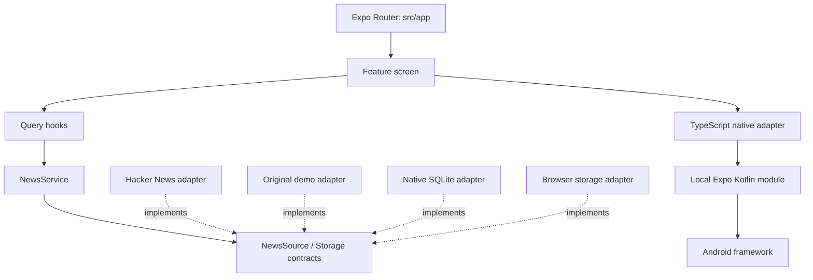

# 02 · 从一条新闻看整个架构

## 1. 五层与依赖方向

`domain` 不知道 React、SQLite 或 Android；`runtime.ts` 是依赖组合点。测试可以直接将来源和存储替换成可控实现。API 换成你的新闻后端时不修改卡片和阅读页。

## 2. 三种状态不是一件事

| 状态 | 归属 | 示例 |
|---|---|---|
| 临时交互 | React state/ref | 搜索文字、分类、操作互斥、朗读状态 |
| 请求与展示 | TanStack Query | 请求中、错误、分页、刷新与跨页收藏失效 |
| 用户数据 | Storage/SQLite | 收藏内容快照、设置、后台执行记录 |

不把服务端数据复制到 Zustand，不让组件直接拼 SQL。设置虽然通过 Query hook 暴露，其事实来源仍是本地存储，并非虚构“设置服务器”。

## 3. 拉取与缓存策略

本实现是 **网络优先 + 持久化回退**，不是完整的 offline-first 同步引擎。HN 一页 15 条，最多 4 个明细请求并行，12 秒请求超时，支持外部 AbortSignal。分页使用 ID 排名快照；刷新首页开始新快照。不同来源独立缓存，不以 Demo 冒充实时源。

HTTP 429 不自动重试；网络/超时/5xx 由 Query 最多重试一次，避免来源过载。成功请求但磁盘写失败仍显示正文，同时明确提示“未写入缓存”。取消请求绝不变成“成功显示旧缓存”。

HN 的 HTML 摘要只做纯文本提取，最终渲染在原生 `Text` 中；提取器不是可用于 WebView 的 HTML sanitizer。链接限制为 HTTPS 且不含账号口令，不执行任意 scheme。

页面的搜索/分类只针对已加载列表，不假装是全站全文搜索。跨页 ID 去重避免刷新排名变化造成重复展示。

## 4. SQLite 数据所有权

`feed_pages(source,page,payload)`：可重建缓存；`bookmarks(id,payload,saved_at)`：用户主动保存的快照；`metadata(key,value)`：设置和后台任务记录。数据结构有运行时校验。

迁移用 `PRAGMA user_version`，初始化使用独占事务；开启 WAL 和 busy timeout；所有动态值使用绑定参数。遇到高版本数据库拒绝启动并提示升级，不清库降级。收藏损坏应暴露问题而不是静默删除；可丢弃缓存损坏可以按 cache miss 处理。

`clearFeedCache` 只删缓存表。提醒先保存快照再请求权限，确保通知冷启动能找到文章。未授权时仍保留刚保存的文章，并明确说明。

Web 的 `storage.web.ts` 仅服务预览，使用 localStorage；它不是原生 SQLite 的行为证明。浏览器配额、禁止存储和多标签并发的能力边界不能冒充多设备同步。

## 5. 原生边界

RN 页面不知道 Kotlin 的类名和系统 Intent。平台差异集中在 `src/native/`，不支持的能力显示说明。后台任务在顶层定义，不依赖某页访问。UI 失焦时清理语音与亮屏状态；通知监听器卸载时移除。

## 6. 为什么没有“企业级大全套”

没有认证后端就不做虚假登录；没有编辑表单就不引入 RHF/Zod；手写的小型契约校验已有测试覆盖，后续契约扩大可以替换为 Zod；没有共享多 App 就不先建 Monorepo。先展示真实边界与调用，再按实际需求扩充。

扩展大型列表时用性能测量决定是否换 FlashList，不把“装了高性能库”等同于性能通过。当前文本列表使用虚拟化 FlatList，关键验证是 Release + 真机，见测试清单。
